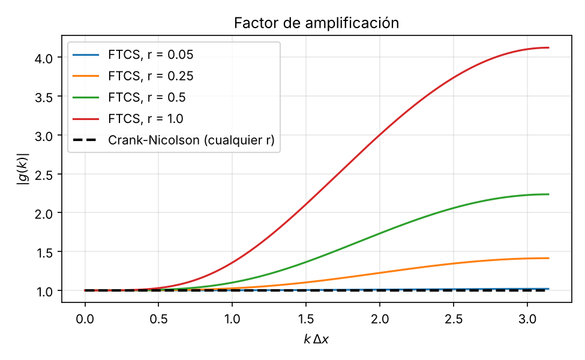
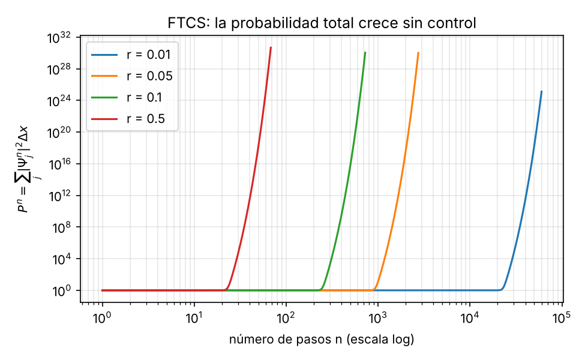
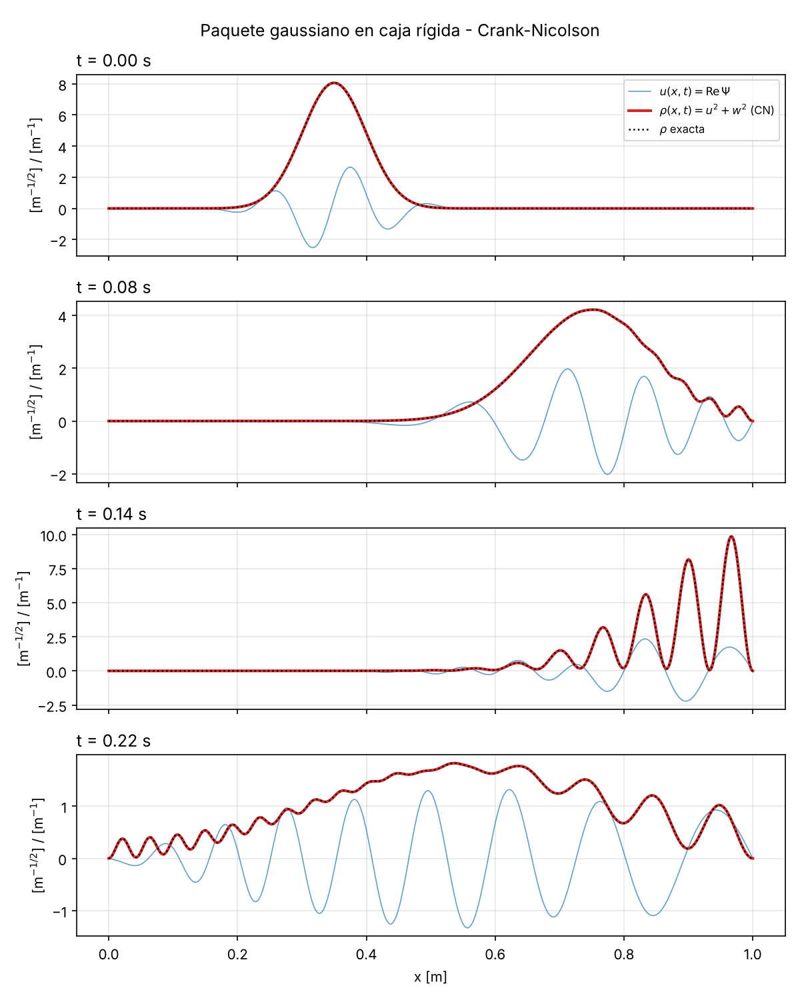
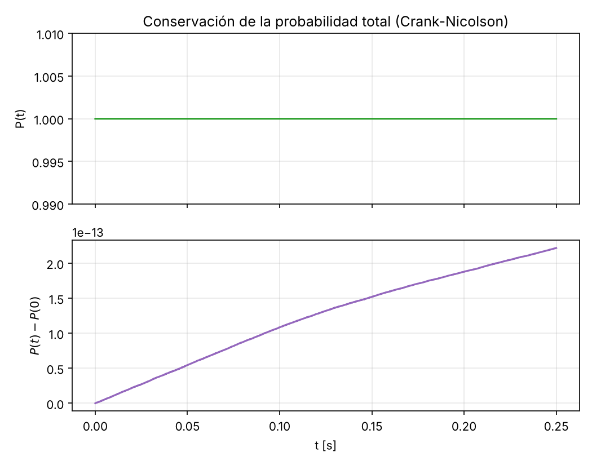
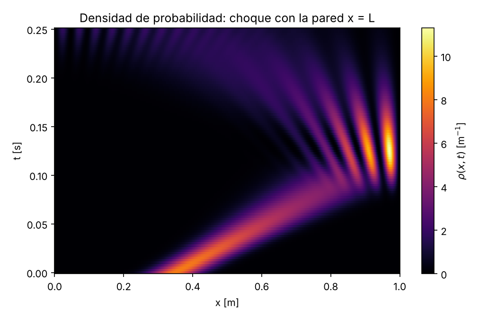

# Bono Computacional Supletorio – Quiz 4 Física Matemática

**Archivos**

- `simulacion_schrodinger.py`: código completo y comentado (FTCS, Crank–Nicolson, validación y gráficas).
- `figuras/`: las gráficas que genera el script.
- `salida_consola.txt`: los números que imprime el script (norma, errores, convergencia).

Para reproducir todo:

```bash
pip install numpy scipy matplotlib
python simulacion_schrodinger.py
```

---

## 0. Forma compacta del problema

Con $\Psi = u + i w$, el sistema (2) es lo mismo que

$$
\frac{\partial \Psi}{\partial t} = i\alpha\,\frac{\partial^2 \Psi}{\partial x^2}.
$$

(Comprobación: $\Psi_t = u_t + i w_t = -\alpha w_{xx} + i\alpha u_{xx} = i\alpha(u_{xx}+i w_{xx}) = i\alpha\Psi_{xx}$.)

En la malla, sea $D_2$ la matriz tridiagonal $\text{tridiag}(1,-2,1)$ sobre los $N_x-1$ nodos interiores (las fronteras $\Psi_0=\Psi_{N_x}=0$ quedan incluidas). Las ecuaciones (6)–(7) se combinan en una sola:

$$
\Psi^{n+1} = \left(I + i r D_2\right)\Psi^{n}, \qquad r=\frac{\alpha\Delta t}{\Delta x^2}.
$$

(Comprobación: $u^{n+1}+iw^{n+1} = u^n - rD_2w^n + i(w^n + rD_2u^n) = \Psi^n + i r D_2 (u^n + i w^n)$.)

**Espectro de $D_2$ con Dirichlet.** Los autovectores son los modos de la caja $\phi^{(m)}_j=\sin(k_m x_j)$, $k_m = m\pi/L$, $m=1,\dots,N_x-1$, con autovalores

$$
\lambda_m = -4\sin^2\!\left(\frac{k_m\Delta x}{2}\right) \in (-4,\,0).
$$

Todos son reales y **estrictamente negativos** ($0 < k_m\Delta x/2 = m\pi/(2N_x) < \pi/2$). $D_2$ es real y simétrica.

---

## 1. Demostración de la inestabilidad incondicional de FTCS (4.0 %)

### 1.1 Factor de amplificación (análisis de von Neumann)

Se propone un modo $u_j^n = U^n e^{ikj\Delta x}$, $w_j^n = W^n e^{ikj\Delta x}$. La diferencia centrada da

$$
e^{ik\Delta x} - 2 + e^{-ik\Delta x} = 2\cos(k\Delta x) - 2 = -4\sin^2\!\left(\tfrac{k\Delta x}{2}\right).
$$

Definiendo $s(k) = 4r\sin^2(k\Delta x/2) \ge 0$, las ecuaciones (6)–(7) quedan

$$
\begin{pmatrix} U^{n+1}\\ W^{n+1}\end{pmatrix}
= \underbrace{\begin{pmatrix} 1 & s\\ -s & 1\end{pmatrix}}_{G(k)}
\begin{pmatrix} U^{n}\\ W^{n}\end{pmatrix}.
$$

Los valores propios de la matriz de amplificación salen de $\det(G - gI) = (1-g)^2 + s^2 = 0$:

$$
g_\pm(k) = 1 \pm i\,s(k), \qquad
\boxed{\;|g(k)| = \sqrt{1 + s(k)^2} = \sqrt{1 + 16\,r^2\sin^4\!\left(\tfrac{k\Delta x}{2}\right)}\;}
$$

(En la forma compleja es lo mismo: $\Psi^{n+1} = (1 - i s)\Psi^n$, es decir, $g = 1 - is$.)

Para **cualquier** $\Delta t>0$ se tiene $r>0$, y para todo modo de la caja $k_m=m\pi/L$ se tiene $\sin(k_m\Delta x/2)\neq 0$, luego $s(k_m) > 0$ y

$$
|g(k_m)| > 1 \quad \forall\, m,\ \forall\,\Delta t > 0.
$$

No existe ningún $r>0$ que cumpla la condición de von Neumann $|g|\le 1$: **el esquema es incondicionalmente inestable**. El modo más rápido es el de malla, $k\Delta x\to\pi$, con $|g|_{\max} = \sqrt{1+16r^2}$. Después de $n$ pasos ese modo se multiplica por $(1+16r^2)^{n/2}$.

> **Nota (por qué achicar $\Delta t$ no lo arregla):** al refinar la malla con $r$ fijo, el número de pasos hasta un tiempo $t$ es $n = t\alpha/(r\Delta x^2)\to\infty$, y la amplificación $(1+16r^2)^{n/2}$ crece sin cota. Un $r$ más pequeño solo **retrasa** la explosión: no la evita. Los errores de redondeo ($\sim10^{-16}$) siempre tienen componente en los modos de alta frecuencia, que acaban dominando. (Lo único que la frenaría es tomar $\Delta t\propto\Delta x^4$, algo inútil en la práctica, y aun así $|g|>1$.)



### 1.2 Explicación física y espectral

- La ecuación de Schrödinger es **conservativa (unitaria)**: el operador $H = -\alpha\,\partial_x^2$ es hermítico, así que $\Psi(t) = e^{-iHt}\Psi(0)$ y cada modo solo rota de fase: el factor exacto es $g_{\text{exacto}} = e^{-i\alpha k^2\Delta t}$, con $|g_{\text{exacto}}| = 1$. No hay disipación que amortigüe los errores, a diferencia de la ecuación del calor.
- En el semidiscreto $\dot\Psi = \frac{i\alpha}{\Delta x^2}D_2\Psi$, los autovalores son $\mu_m = i\alpha\lambda_m/\Delta x^2$: **puramente imaginarios**.
- Euler explícito aplicado a $\dot y = \mu y$ da $y^{n+1} = (1+\mu\Delta t)y^n$. Su región de estabilidad, $|1+\mu\Delta t|\le1$, es el disco de radio 1 centrado en $-1$, que toca al eje imaginario **solo en el origen**. Para $\mu = i\omega$ con $\omega\neq0$, $|1 + i\omega\Delta t| = \sqrt{1+\omega^2\Delta t^2} > 1$ siempre. Por eso, por pequeño que sea $\Delta t$, todos los modos quedan fuera de la región de estabilidad.
- Geométricamente: Euler avanza por la **tangente** a una circunferencia (la rotación de fase $u + iw$); cada paso por la tangente aleja el punto del origen, así que la amplitud crece en cada paso.

### 1.3 Qué le pasa a la probabilidad total discreta

Con $P^n = \Delta x\sum_j |\Psi_j^n|^2 = \Delta x\,\|\Psi^n\|^2$ y $\Psi^{n+1} = \Psi^n + i r D_2\Psi^n$:

$$
\|\Psi^{n+1}\|^2 = \|\Psi^n\|^2
+ \underbrace{i r\langle\Psi^n, D_2\Psi^n\rangle - i r\langle D_2\Psi^n,\Psi^n\rangle}_{=\,0\ \text{(pues } D_2 \text{ es real simétrica, } \langle\Psi,D_2\Psi\rangle\in\mathbb R)}
+ r^2\|D_2\Psi^n\|^2 .
$$

Por lo tanto

$$
\boxed{\;P^{n+1} = P^n + r^2\Delta x\sum_j\left|(D_2\Psi^n)_j\right|^2 \;>\; P^n\;}
$$

La probabilidad **crece estrictamente en cada paso** (salvo $\Psi\equiv0$). Expandiendo en los modos de la caja, $\Psi^0 = \sum_m c_m\phi^{(m)}$:

$$
P^n = \sum_m |c_m|^2\,(1+s_m^2)^n \;\xrightarrow{\,n\to\infty\,}\; \infty ,
$$

y queda dominada por los modos de longitud de onda más corta. Esto viola $P=1$ (ec. 5): la "partícula" deja de tener sentido probabilístico.

**Comprobación numérica** (`figuras/2_ftcs_norma.png`, $N_x = 200$):

| $r$ | pasos hasta $P > 10^{30}$ |
|---|---|
| 0.50 | 67 |
| 0.10 | 723 |
| 0.05 | 2 736 |
| 0.01 | $P = 1.3\times10^{25}$ a los 60 000 pasos |



---

## 2. Método estable: Crank–Nicolson (6.0 %)

### 2.1 Esquema

Se promedia el lado derecho entre $t_n$ y $t_{n+1}$ (regla del trapecio en el tiempo):

$$
\frac{\Psi^{n+1}-\Psi^n}{\Delta t} = \frac{i\alpha}{2\Delta x^2}D_2\left(\Psi^{n+1}+\Psi^n\right)
\;\Longrightarrow\;
\boxed{\left(I - \tfrac{ir}{2}D_2\right)\Psi^{n+1} = \left(I + \tfrac{ir}{2}D_2\right)\Psi^{n}}
$$

En variables reales (lo que pide el sistema (2)):

$$
u_j^{n+1} + \tfrac r2\,\delta^2 w_j^{n+1} = u_j^n - \tfrac r2\,\delta^2 w_j^n,\qquad
w_j^{n+1} - \tfrac r2\,\delta^2 u_j^{n+1} = w_j^n + \tfrac r2\,\delta^2 u_j^n,
$$

con $\delta^2 f_j = f_{j+1}-2f_j+f_{j-1}$. En cada paso se resuelve un sistema **tridiagonal** complejo (en el código la matriz se factoriza LU una sola vez con `scipy.sparse.linalg.splu`). El esquema es de orden $O(\Delta t^2 + \Delta x^2)$.

### 2.2 Prueba de estabilidad incondicional

**Von Neumann.** Con $\Psi_j^n = G^n e^{ikj\Delta x}$ y $s = 4r\sin^2(k\Delta x/2)$:

$$
\left(1 + \tfrac{i s}{2}\right)G^{n+1} = \left(1 - \tfrac{i s}{2}\right)G^{n}
\;\Longrightarrow\;
g(k) = \frac{1 - i s/2}{1 + i s/2},
\qquad
|g(k)| = \frac{\sqrt{1+s^2/4}}{\sqrt{1+s^2/4}} = 1 .
$$

$|g(k)|=1$ **exactamente, para todo $k$ y todo $r>0$**: Crank–Nicolson es incondicionalmente estable y además no disipa ni amplifica (la condición $|g|\le1$ se cumple sin ninguna restricción sobre $r$).

**Prueba matricial (conservación exacta de la norma con las fronteras).** Sea $A = I - \tfrac{ir}{2}D_2$. Como $D_2$ es real y simétrica, $A^* = I + \tfrac{ir}{2}D_2$ (adjunta), y $A$ es invertible porque sus autovalores $1 - \tfrac{ir}{2}\lambda_m$ tienen parte real 1. El paso es

$$
\Psi^{n+1} = U\Psi^n,\qquad U = A^{-1}A^* .
$$

$A$ y $A^*$ conmutan (ambas son polinomios en $D_2$), así que

$$
U^*U = A\,(A^*)^{-1}A^{-1}A^* = A A^{-1}(A^*)^{-1}A^* = I .
$$

$U$ es **unitaria** (es la transformada de Cayley del hermítico $\tfrac r2 D_2$), con autovalores $\dfrac{1 - i r\lambda_m/2}{1 + i r\lambda_m/2}$ de módulo 1. Entonces

$$
\boxed{P^{n+1} = \Delta x\,\|U\Psi^n\|^2 = \Delta x\,\|\Psi^n\|^2 = P^n}
$$

para todo $n$ y cualquier $\Delta t$: la probabilidad discreta se conserva **exactamente** (salvo redondeo). Es la versión discreta de la unitariedad de $e^{-iHt}$.

**Precisión (la estabilidad no basta).** CN no explota, pero sí tiene error de fase: su fase por paso es $2\arctan(s/2)$ frente a la exacta $\alpha k^2\Delta t$. Para resolver bien el paquete hace falta

- $k_0\Delta x \ll 1$: con $\Delta x = 10^{-3}$ m, $k_0\Delta x = 0.05$ (≈ 125 puntos por longitud de onda $2\pi/k_0 = 0.126$ m);
- $\alpha k_0^2\Delta t \ll 1$: con $\Delta t = 10^{-4}$ s, $\alpha k_0^2\Delta t = 0.0125$ rad.

Por eso se usó $\Delta x = 10^{-3}$ m, $\Delta t = 10^{-4}$ s ($r = 5$, un valor con el que FTCS explotaría en pocos pasos).

### 2.3 Validación

1. **Solución exacta por el método de imágenes.** La gaussiana libre en $\mathbb R$ evoluciona como

$$
\Psi_{\text{libre}}(x,t) = \frac{A}{\sqrt{1+i\tau}}\, e^{i(k_0x-\alpha k_0^2 t)}
\exp\!\left[-\frac{(x - x_0 - 2\alpha k_0 t)^2}{2\sigma^2(1+i\tau)}\right],\qquad \tau = \frac{2\alpha t}{\sigma^2}.
$$

Las paredes rígidas se imponen con la extensión **impar y $2L$-periódica** de la condición inicial (cada imagen especular es una gaussiana en $-x_0$ con número de onda $-k_0$, con signo menos). Esto da la solución exacta en la caja, **incluso durante la reflexión**.

| $t$ [s] | $\max\lvert\rho_{\text{CN}}-\rho_{\text{exacta}}\rvert$ | $\max\rho$ |
|---|---|---|
| 0.04 | $6.8\times10^{-3}$ | 6.24 |
| 0.14 | $2.0\times10^{-2}$ | 9.84 |
| 0.25 | $1.7\times10^{-2}$ | 1.95 |

2. **Convergencia** (error en $t = 0.25$ s al reducir $\Delta x$ y $\Delta t$ a la mitad):

| $N_x$ | $\Delta t$ [s] | error | cociente |
|---|---|---|---|
| 500 | $2\times10^{-4}$ | $6.91\times10^{-2}$ | — |
| 1000 | $1\times10^{-4}$ | $1.74\times10^{-2}$ | 3.97 |
| 2000 | $5\times10^{-5}$ | $4.36\times10^{-3}$ | 3.99 |

El error baja un factor ≈ 4 al dividir el paso por 2: **orden 2**, como predice la teoría.

3. **Norma:** $P(0) = 0.999\,999\,999\,999$ (la gaussiana es despreciable fuera de $[0,L]$) y $\max_t|P(t)-P(0)| = 2.2\times10^{-13}$ (solo redondeo acumulado en 2500 pasos).

### 2.4 Resultados







### 2.5 Interpretación física

- **Movimiento y dispersión.** El paquete viaja con velocidad de grupo $v_g = d\omega/dk = 2\alpha k_0 = 5$ m/s y se ensancha como $\sigma(t) = \sigma\sqrt{1 + (2\alpha t/\sigma^2)^2}$ (en $t = 0.08$ s, $\sigma \approx 0.13$ m). El centro llegaría a $x = L$ en $t = (L-x_0)/v_g = 0.13$ s.
- **$t = 0.08$ s:** el frente ya toca la pared y aparecen las primeras ondulaciones en $\rho$ cerca de $x = L$.
- **$t = 0.14$ s:** el paquete está chocando con la pared. La onda incidente ($+k_0$) y la reflejada ($-k_0$) se superponen y $\rho$ muestra **franjas de interferencia** con separación ≈ $\pi/k_0 = 0.063$ m (onda estacionaria $\sim\sin^2(k_0(L-x))$), con $\rho = 0$ en la pared.
- **$t = 0.22$ s:** la mayor parte ya se reflejó y viaja hacia la izquierda, muy dispersa; las componentes lentas del paquete aún interfieren con las rápidas que ya volvieron (incluso llegan a la pared izquierda), por eso persisten las franjas.
- En todo el proceso $P(t) = 1$: la reflexión en una pared rígida no destruye probabilidad, y el esquema numérico lo respeta exactamente porque es unitario.

### 2.6 Conclusión

FTCS falla porque aplica un método cuya región de estabilidad no contiene el eje imaginario a un problema cuyo espectro es puramente imaginario: $|g| = \sqrt{1+s^2} > 1$ para todo $\Delta t$ y la norma crece en cada paso. Crank–Nicolson es la transformada de Cayley del hamiltoniano discreto: es unitario ($|g| = 1$ exactamente), conserva la probabilidad hasta el redondeo, es incondicionalmente estable y de segundo orden. Su única restricción es de **precisión** (resolver $k_0$ en espacio y tiempo), no de estabilidad.
