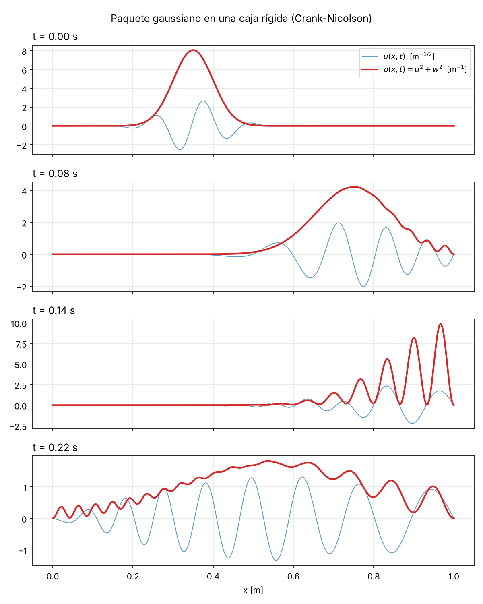
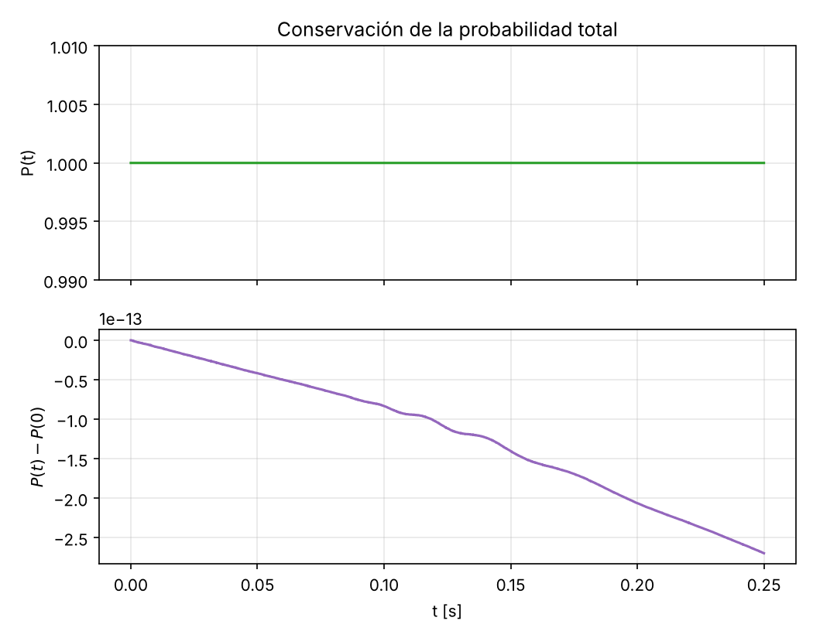

**Formulación compacta.** Con $\Psi = u + i w$, el sistema (2) equivale a $\Psi_t = i\alpha\,\Psi_{xx}$, pues $\Psi_t = -\alpha w_{xx} + i\alpha u_{xx} = i\alpha(u_{xx}+i w_{xx})$. En la malla, sea $D_2 = \mathrm{tridiag}(1,-2,1)$ sobre los $N_x-1$ nodos interiores (las fronteras $\Psi_0=\Psi_{N_x}=0$ quedan incluidas). $D_2$ es real y simétrica, con autovectores $\sin(k_m x_j)$, $k_m = m\pi/L$, y autovalores

$$\lambda_m = -4\sin^2\!\left(\tfrac{k_m\Delta x}{2}\right)\in(-4,0),\qquad m = 1,\dots,N_x-1 .$$

Con esto, las ecuaciones (6)–(7) se escriben como una sola: $\Psi^{n+1} = (I + i r D_2)\,\Psi^n$.

# 1. Demostración de la inestabilidad incondicional

## 1.1 Factor de amplificación

Se sustituye un modo de Fourier $u_j^n = U^n e^{ikj\Delta x}$, $w_j^n = W^n e^{ikj\Delta x}$ en (6)–(7). Como

$$e^{ik\Delta x}-2+e^{-ik\Delta x} = -4\sin^2\!\left(\tfrac{k\Delta x}{2}\right),$$

y definiendo $s(k) = 4r\sin^2(k\Delta x/2)\ge 0$, se obtiene

$$\begin{pmatrix}U^{n+1}\\ W^{n+1}\end{pmatrix} = \begin{pmatrix}1 & s\\ -s & 1\end{pmatrix}\begin{pmatrix}U^{n}\\ W^{n}\end{pmatrix}.$$

Los valores propios cumplen $(1-g)^2 + s^2 = 0$, es decir,

$$g_\pm(k) = 1 \pm i\,s(k),\qquad |g(k)| = \sqrt{1+s(k)^2} = \sqrt{1+16\,r^2\sin^4\!\left(\tfrac{k\Delta x}{2}\right)} .$$

Para cualquier $\Delta t > 0$ se tiene $r > 0$, y para todo modo de la caja $\sin(k_m\Delta x/2)\neq 0$, luego $s(k_m) > 0$ y

$$|g(k_m)| > 1\qquad \forall\,m,\ \forall\,\Delta t>0 .$$

Ningún valor de $r$ satisface la condición de von Neumann $|g|\le 1$: **el esquema es incondicionalmente inestable**. El modo más amplificado es el de longitud de onda de malla ($k\Delta x\to\pi$), con $|g|_{\max} = \sqrt{1+16r^2}$. Al refinar la malla con $r$ fijo, el número de pasos hasta un tiempo $t$ es $n = t\alpha/(r\Delta x^2)\to\infty$ y el factor $(1+16r^2)^{n/2}$ crece sin cota; reducir $r$ solo retrasa la divergencia. Los errores de redondeo siempre excitan esos modos, que terminan dominando la solución.

## 1.2 Explicación física y espectral

La ecuación de Schrödinger es **conservativa**: $H = -\alpha\,\partial_x^2$ es hermítico y la evolución $e^{-iHt}$ es unitaria. Cada modo solo rota su fase, con factor exacto $e^{-i\alpha k^2\Delta t}$ de módulo 1; no hay disipación que amortigüe los errores.

El sistema semidiscreto $\dot\Psi = \frac{i\alpha}{\Delta x^2}D_2\Psi$ tiene autovalores $\mu_m = i\alpha\lambda_m/\Delta x^2$ **puramente imaginarios**. Euler explícito aplicado a $\dot y = \mu y$ da $y^{n+1} = (1+\mu\Delta t)\,y^n$, cuya región de estabilidad $|1+\mu\Delta t|\le 1$ es el disco de radio 1 centrado en $-1$, que toca el eje imaginario solo en el origen. Para $\mu = i\omega$, $\omega\neq0$: $|1+i\omega\Delta t| = \sqrt{1+\omega^2\Delta t^2} > 1$ para todo $\Delta t$. Geométricamente, Euler avanza por la tangente a la circunferencia que describe la rotación de fase en el plano $(u,w)$, y cada paso aleja el punto del origen.

## 1.3 Probabilidad total discreta

Con $P^n = \Delta x\,\|\Psi^n\|^2$ y $\Psi^{n+1} = \Psi^n + i r D_2\Psi^n$:

$$\|\Psi^{n+1}\|^2 = \|\Psi^n\|^2 + i r\langle\Psi^n,D_2\Psi^n\rangle - i r\langle D_2\Psi^n,\Psi^n\rangle + r^2\|D_2\Psi^n\|^2 .$$

Como $D_2$ es real y simétrica, $\langle\Psi,D_2\Psi\rangle\in\mathbb{R}$ y los términos cruzados se cancelan:

$$P^{n+1} = P^n + r^2\,\Delta x\sum_j\big|(D_2\Psi^n)_j\big|^2 \;>\; P^n .$$

La probabilidad **crece estrictamente en cada paso**. Expandiendo $\Psi^0 = \sum_m c_m\sin(k_m x)$,

$$P^n = \sum_m |c_m|^2\,(1+s_m^2)^n \longrightarrow \infty ,$$

dominada por los modos de longitud de onda más corta. Se viola la normalización $P = 1$ (ec. 5) y la solución pierde todo significado físico: por eso el código diverge explosivamente.

# 2. Método estable: Crank–Nicolson

## 2.1 Esquema

Se evalúa el lado derecho como el promedio entre $t_n$ y $t_{n+1}$ (regla del trapecio):

$$\left(I - \tfrac{ir}{2}D_2\right)\Psi^{n+1} = \left(I + \tfrac{ir}{2}D_2\right)\Psi^{n}.$$

En variables reales, con $\delta^2 f_j = f_{j+1}-2f_j+f_{j-1}$:

$$u_j^{n+1} + \tfrac r2\,\delta^2 w_j^{n+1} = u_j^n - \tfrac r2\,\delta^2 w_j^n,\qquad w_j^{n+1} - \tfrac r2\,\delta^2 u_j^{n+1} = w_j^n + \tfrac r2\,\delta^2 u_j^n .$$

Es un sistema lineal disperso que se factoriza una sola vez (LU) y se resuelve en cada paso. El error de truncamiento es $O(\Delta t^2+\Delta x^2)$.

## 2.2 Prueba de estabilidad incondicional

**Von Neumann.** Con $\Psi_j^n = G^n e^{ikj\Delta x}$ y $s = 4r\sin^2(k\Delta x/2)$:

$$\left(1+\tfrac{is}{2}\right)G^{n+1} = \left(1-\tfrac{is}{2}\right)G^n \;\Longrightarrow\; g(k) = \frac{1-is/2}{1+is/2},\qquad |g(k)| = \frac{\sqrt{1+s^2/4}}{\sqrt{1+s^2/4}} = 1 .$$

$|g(k)| = 1$ **para todo $k$ y todo $r>0$**: el método es incondicionalmente estable, sin restricción sobre $r = \alpha\Delta t/\Delta x^2$, y no amplifica ni amortigua ningún modo.

**Prueba matricial (conservación exacta de la norma).** Sea $A = I - \tfrac{ir}{2}D_2$. Como $D_2$ es real simétrica, $A^* = I + \tfrac{ir}{2}D_2$, y $A$ es invertible porque sus autovalores $1 - \tfrac{ir}{2}\lambda_m$ tienen parte real 1. El paso es $\Psi^{n+1} = U\Psi^n$ con $U = A^{-1}A^*$. Como $A$ y $A^*$ son polinomios en $D_2$, conmutan, y

$$U^*U = A\,(A^*)^{-1}A^{-1}A^* = I .$$

$U$ es **unitaria** (transformada de Cayley del operador hermítico $\tfrac r2 D_2$), con autovalores $\frac{1-ir\lambda_m/2}{1+ir\lambda_m/2}$ de módulo 1. Por lo tanto

$$P^{n+1} = \Delta x\,\|U\Psi^n\|^2 = \Delta x\,\|\Psi^n\|^2 = P^n ,$$

para todo $n$ y cualquier $\Delta t$: es la versión discreta de la unitariedad de la evolución cuántica.

**Elección de la malla.** La estabilidad no garantiza precisión; para resolver la fase del paquete se requiere $k_0\Delta x\ll1$ y $\alpha k_0^2\Delta t\ll1$. Se usó $\Delta x = 10^{-3}$ m ($k_0\Delta x = 0.05$) y $\Delta t = 10^{-4}$ s ($\alpha k_0^2\Delta t = 0.0125$ rad), lo que da $r = 5$, un valor con el que FTCS divergiría en pocos pasos.

## 2.3 Resultados de la simulación

El código `bono_schrodinger.py` integra el sistema hasta $t_{\text{final}} = 0.25$ s con los parámetros de la Tabla 1 y genera directamente las dos figuras.

{width=88%}

{width=72%}

**Conservación de la norma.** $P(0) = 0.999\,999\,999\,999$ y $\max_t|P(t)-P(0)| \approx 3\times10^{-13}$ durante los 2500 pasos: la norma se conserva hasta el error de redondeo, como predice la prueba de unitariedad.

**Interpretación física.**

- El paquete viaja con velocidad de grupo $v_g = 2\alpha k_0 = 5$ m/s y se ensancha como $\sigma(t) = \sigma\sqrt{1+(2\alpha t/\sigma^2)^2}$; su centro alcanzaría la pared en $t = (L-x_0)/v_g = 0.13$ s.
- $t = 0.08$ s: el paquete se ha dispersado ($\sigma\approx0.13$ m) y su frente ya alcanza la pared $x = L$, donde aparecen las primeras ondulaciones.
- $t = 0.14$ s: el paquete está colisionando con la pared. La onda incidente ($+k_0$) y la reflejada ($-k_0$) se superponen y $\rho$ presenta franjas de interferencia separadas aproximadamente $\pi/k_0 \approx 0.063$ m, con $\rho = 0$ en la pared.
- $t = 0.22$ s: la mayor parte del paquete ya se reflejó y viaja hacia la izquierda, muy disperso; persisten franjas por la interferencia entre las componentes rápidas que ya rebotaron y las lentas que aún no lo hacen.

## 2.4 Conclusión

FTCS fracasa porque Euler explícito tiene una región de estabilidad que no contiene el eje imaginario, mientras que el espectro del operador de Schrödinger es puramente imaginario: $|g| = \sqrt{1+s^2} > 1$ para todo $\Delta t$ y la probabilidad crece en cada paso. Crank–Nicolson es unitario ($|g| = 1$ exactamente), incondicionalmente estable y de segundo orden, y conserva la probabilidad total hasta el redondeo, como confirma la simulación.
